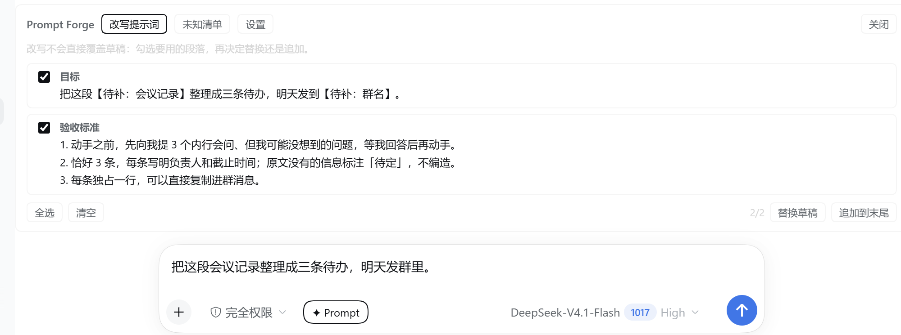
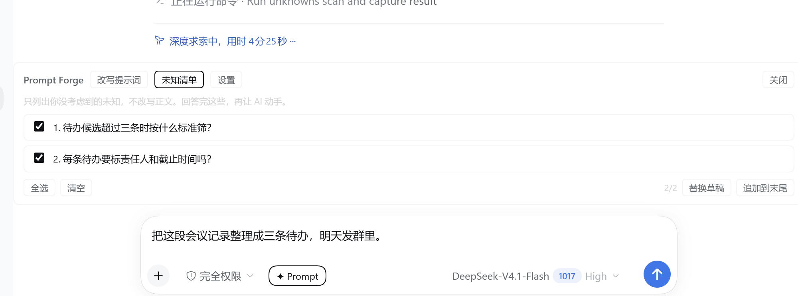
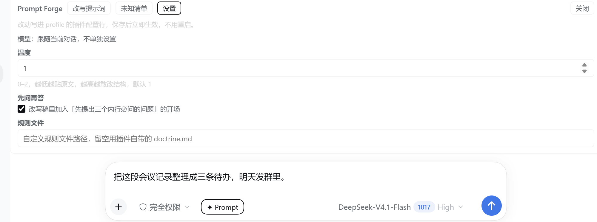

# Prompt Forge · 提示词工坊

输入框旁边的一个 `✦ Prompt` 按钮：把草稿改写成一个更可执行的提示词，列出你没说但会被追问的未知，并且让插件自己的设置也能在面板里改。
改写结果以「按行勾选」的形式返回——**不自动覆盖你的草稿**，你自己决定哪几行替换或追加。

> 改写规则来自三篇公开文章被压缩成的一套可机检条目（见 [简介](#简介) 的心法映射表）：
> [《找到你的未知》](https://claude.com/blog/a-field-guide-to-claude-fable-finding-your-unknowns)（先找未知，再动手）、
> [《删掉 80%》](https://claude.com/blog/the-new-rules-of-context-engineering-for-claude-5-generation-models)（给判据不给禁令，上下文做减法）、
> [《更有野心》](https://felixrieseberg.com/how-to-be-more-ambitious-a-tutorial-for-humans-with-models/)（目标具体且难，别只求快）。
> 规则放在仓库里的 [doctrine.md](doctrine.md)，可以整份替换成你团队的规范。



| 未知清单 | 设置 |
| --- | --- |
|  |  |

## 简介

**它做什么**

- 一个按钮、一个面板、三个页签：
  - **改写提示词**：把草稿改成「目标 + 可外部验证的验收标准（+ 必要的背景/交付格式）」的结构；句子长短、条目多少跟着任务复杂度走，不套固定模板。
  - **未知清单**：只列「内行会追问、你多半没想到」的问题，一行一个问句，不写解释，也不替你改写全文。
  - **设置**：温度、「先问再答」开关、自定义规则文件路径，改完即时生效，不用重启。
- 结果按行返回并可勾选：`替换草稿` / `追加到末尾` / `全选` / `清空`，草稿在你按下按钮之前和之后都不被改动。
- 每条结果在服务端先过一次机器复查（节数、字数、条目数、形容词判据、复述目标的节、列点是否编号），不合格会带着整改要求重写一次。

**它刻意不做**

- 不向模型暴露任何工具：agent 不会替你调用它（v0.6 起移除 agent 工具），只有你在输入框点按钮才会跑。
- 不写会话记录、不落盘草稿：草稿只发给你在 DSH 里配置的模型服务商。
- 不替你决定用哪个模型：永远跟随当前对话的模型。

**改写依据（心法映射）**

| 规则 | 对应做法 |
| --- | --- |
| 先找未知，再动手 | 「先问再答」开关打开时，改写稿要求对方先提出 3 个内行必问、外行想不到的问题 |
| 给判据不给禁令 | 把「不要啰嗦」改写成「每条不超过 30 字、不超过 5 条」这类第三方可逐条核对的判据；形容词式判据会被机器复查拦下 |
| 目标具体且难 | 补上数量、字段、格式、可否直接使用等硬约束 |
| 便宜的原型 | 默认只给两节，够用就不加节；不为对称凑五节 |
| 关键处留白给人 | 原文没给的信息写成【待补：…】占位，不编造 |
| 每一节都要有新信息 | 只复述目标的节会被删掉（机器复查会报 `duplicate-section`） |
| 篇幅跟复杂度匹配 | 按草稿字数四档给硬预算（见 [配置](#配置) 下方表格） |
| 列点要能逐条勾选 | 列点必须编号、一条一行，压成段落会被机器复查拦下 |

## 安装

### 前置条件

| 条件 | 要求 | 说明 |
| --- | --- | --- |
| DSH | `>= 0.2.1-rc.1 < 0.3.0`（在 `0.2.1-rc.3` 上验证） | 需要 `conversation.input.left` / `conversation.input.dock` 插槽与 `configEditor` 服务 |
| Node.js | `^22.19.0` 或 `>= 24.0.0`（在 `24.21.0` 上验证） | 仅用于安装依赖与跑测试 |
| pnpm | 任意近期版本 | 安装 `@deepseek-ai/schemastery`（devDependency） |
| git | 任意近期版本 | 克隆仓库 |

> 本插件目前**未发布到 npm**，所以安装方式是从源码目录（或打包出的 `.tgz`）装进你的 DSH profile。

### 方式 A：从源码目录安装（推荐）

```sh
git clone https://github.com/wlllyj/dsh-prompt-forge.git
cd dsh-prompt-forge
pnpm install
```

然后在 DSH 里把这个目录装成插件。在 DSH 桌面版/Web 版中，插件安装由插件管理器完成（等价于 agent 侧工具 `plugin_manager` 的 `install_bundle`）：

```text
在 DSH 会话里对 agent 说：
把 <你克隆下来的 dsh-prompt-forge 目录绝对路径> 用 plugin_manager install_bundle 装成插件
```

装完**刷新页面**（F5），输入框左侧会出现 `✦ Prompt`。

### 方式 B：打包成 tgz 再装

```sh
git clone https://github.com/wlllyj/dsh-prompt-forge.git
cd dsh-prompt-forge
pnpm install
pnpm pack      # 生成 dsh-prompt-forge-<version>.tgz
```

把生成的 `.tgz` 路径交给 `plugin_manager install_bundle`，同样刷新页面。

### 方式 C：直接装预构建的 tgz（不用装 Node/pnpm）

每次发版都会把打好包的 tgz 挂在 GitHub Release 上：

```sh
curl -L -o dsh-prompt-forge-0.9.4.tgz \
  https://github.com/wlllyj/dsh-prompt-forge/releases/download/v0.9.4/dsh-prompt-forge-0.9.4.tgz
```

把下载到的 `.tgz` 路径交给 `plugin_manager install_bundle`，然后刷新页面。

### 安装后自检

1. 输入框左侧出现 `✦ Prompt` 胶囊（与已有的其它输入框按钮并排）。
2. 设置 → 插件里能看到 `dsh-prompt-forge`，状态为启用。
3. 点击按钮 → 面板出现在输入框上方，三个页签可切换。

命令行自检（`<port>` 换成你 DSH Web 服务端口，桌面版常见为 `31021`）：

```sh
curl -s http://127.0.0.1:<port>/promptforge/config
```

返回 `{"ok":true,"value":{"values":{...},"defaults":{...}}}` 即宿主半边已就位。

## 用法

1. 在输入框写下草稿（哪怕一句话也行）。
2. 点 `✦ Prompt`，选择页签：**改写提示词** 或 **未知清单**。
3. 等结果按行列出来；不想要的取消勾选，想保留多条就全选。
4. 点 `替换草稿`（用选中的行覆盖草稿）或 `追加到末尾`（保留原草稿，把选中内容接在后面），或直接 `关闭`。

每个页签各自保留上次结果：切页签不会重跑，也不会覆盖另一个页签的结果。

**示例（改写）**

草稿（21 字）：

```text
把这段会议记录整理成三条待办，明天发群里。
```

点「改写提示词」后（127 字、2 节，实测会在 130–180 字间浮动）：

```text
## 目标
把这段会议记录整理成三条待办，明天发群里。

## 验收标准
1. 先只向我提三个「内行必问」的问题；我回答后，你再动手。
2. 恰好三条，每条一行，包含：动作、负责人、截止时间。
3. 记录里没写明的负责人或时间，标「【待补】」，不要猜测。
```

**示例（未知清单）**

同一条草稿，点「未知清单」后（2 条、38 字）：

```text
1. 三条是恰好三条还是最多三条？
2. 每条待办要不要写负责人和截止时间？
```

**直接调接口**（脚本/自动化用，`<port>` 同上）：

```sh
printf '%s' '{"text":"把这段会议记录整理成三条待办，明天发群里。"}' > body.json
curl -s -X POST http://127.0.0.1:<port>/promptforge/optimize \
  -H 'content-type: application/json' --data-binary @body.json
```

返回：

```json
{"ok":true,"value":{"text":"…","parts":[{"heading":"目标","body":"…"}],"provider":"<provider>","model":"<model>"}}
```

## 配置

全部配置都在面板的 **设置** 页签里，改完点 `保存` 即生效（配置写入你的 profile 的 `cordis.patch.yml`，volatile 字段热更新，不需要重启）。

| 字段 | 默认 | 范围 | 说明 |
| --- | --- | --- | --- |
| `temperature` | `1` | `0–2` | 改写温度；越高越敢替你补判据，也更容易出现措辞浮动 |
| `askFirst` | `true` | 布尔 | 开＝改写稿要求对方先问 3 个问题再动手；关＝改成写出「我据此推断的前提 / 仍需确认的点」 |
| `doctrinePath` | `""` | 路径 | 自定义规则文件；留空用仓库里的 `doctrine.md`，支持绝对路径或相对插件目录的路径 |

**模型不可配置**：改写永远使用当前对话的模型（宿主 `agentDefaultModel.currentSelection()`），避免同一份提示词在不同模型下改出两套风格。

**篇幅预算（自动，不占配置项）**

| 草稿字数 | 改写上限 | 未知清单上限 |
| --- | --- | --- |
| < 40 字（tiny） | ≤ 150 字、≤ 2 节 | ≤ 2 条 / 70 字 / 每条 ≤ 28 字 |
| < 200 字（small） | ≤ 240 字、≤ 3 节 | ≤ 3 条 / 120 字 / 每条 ≤ 32 字 |
| < 800 字（normal） | ≤ 900 字、≤ 4 节 | ≤ 5 条 / 260 字 / 每条 ≤ 42 字 |
| ≥ 800 字（large） | ≤ 字数 × 1.4、≤ 5 节 | ≤ 6 条 / 420 字 / 每条 ≤ 60 字 |

**规则文件**：把 [doctrine.md](doctrine.md) 整份替换成团队规范即可；也可以只把 `doctrinePath` 指向另一个文件（比如放在共享盘上），插件每次请求都会重新读取，不需要重启或重装。规则文件缺失或读不到时回退到内置副本。

## 许可证

本项目使用 **MIT** 许可证，全文见 [LICENSE](LICENSE)，版权人 `wlllyj`。

用人话说，这意味着：

- **你可以**：任意使用、修改、再发布，包括用在闭源产品或商业项目里，不需要付费，也不需要公开你的改动。
- **你必须**：保留原版权声明和许可证文本（分发本项目的副本或修改版时把 `LICENSE` 一起带上）。
- **不提供担保**：软件按「现状」提供，作者不对使用后果负责。

选 MIT 的理由：它是插件生态里最常见、接受度最高的许可证，`dsh-market` 上架不挑许可证类型，MIT 不会给任何一方增加合规负担；如果以后想把项目并进采用 Apache-2.0 的组织，MIT 代码也可以直接吸收。

## 贡献

前置：Node `^22.19.0 || >=24`、pnpm、git。

```sh
git clone https://github.com/wlllyj/dsh-prompt-forge.git
cd dsh-prompt-forge
pnpm install
node --test       # 35 个用例
node --check index.js client.js
```

约定：

- 改规则：优先改 `doctrine.md`；如果改的是内置副本 `BUILTIN_DOCTRINE`（`index.js`），必须让它与 `doctrine.md` 逐字一致——测试会守这一条。
- 改机器复查：`reviewRewrite` / `reviewUnknowns` 的每一类问题都要有正例与反例测试。
- 文档里不要写个人本机绝对路径。
- 改了行为就升 `package.json` 的 `version`，并在 README 的「开发与验证」里补一行验证记录。
- PR 请说明：改了什么行为、怎么验证的（命令 + 实际输出）。

## 常见问题

**1. 装完看不到 `✦ Prompt` 按钮？**
先刷新页面；再确认设置 → 插件里 `dsh-prompt-forge` 处于启用状态。若插件列表里没有它，说明 `install_bundle` 没成功（安装会返回 `application` 与 `warnings`，请看返回值）。

**2. 点按钮后报错或一直没有结果？**
改写会调用当前对话的模型，模型不可用/超时会返回错误信封。`empty-answer` 表示模型把 token 预算花在了思考上、正文为空，插件会自动重试一次（加大预算、去掉 reasoning 强度）；仍失败就换个说法再试。

**3. 改写出来还是太长？**
篇幅是软约束：宿主给硬预算、模型写超了会被退回重写一次，但只纠一次。想更严格可以把 `doctrine.md` 里的字数要求改得更硬，或换更听话的模型。

**4. 在设置里保存失败怎么办？**
保存走宿主 `configEditor`，会写你 profile 的 `cordis.patch.yml`。如果该条目被 home patch 或命令行 overlay 覆盖，保存会被拒绝——此时请改那份覆盖文件。

**5. 能让 agent 自动调用这个插件吗？**
不能，是刻意设计：改提示词应该由人按下按钮再决定用哪几行。v0.6 起插件不再向模型暴露任何工具。

**6. 为什么结果不直接替换输入框？**
早期的版本会直接覆盖草稿，实测反而更烦：多数改写只有一两行是你要的。现在按行勾选、由你决定替换还是追加。

**7. 支持哪些模型/provider？**
改写跟随当前对话模型，不做额外适配。其它 provider 上的表现【待补：多 provider 实测记录】。

**8. 英文草稿会被改写成中文吗？**
规则文件是中文写的，英文草稿的产出语言【待补：实测与双语规则】。

**9. 改了 `doctrine.md` 要重启吗？**
不用。每次请求都会重新读规则文件。

**10. 我的草稿会被存到哪里？**
只在请求时发给你配置的模型服务商；插件不写会话记录、不落盘草稿。日志里是否出现草稿正文【待补：确认 DSH 请求日志策略】。

**11. 安装时 pnpm 提示 peer dependency 警告（`@deepseek-ai/schemastery`）？**
从本地目录安装时这条警告属于预期：peer 由宿主提供，插件的 `devDependencies` 已装一份供本地解析。只要 `✦ Prompt` 能出现、`/promptforge/config` 能返回，就可以忽略。

## 上架 dsh-market

**提交到哪个仓库**：dsh-market 应用本身不收录条目，条目来自策展仓库 [`awesome-dsh-plugin/awesome-dsh-plugin`](https://github.com/awesome-dsh-plugin/awesome-dsh-plugin)。投稿只需给那个仓库开 PR，新增**一个文件**：

```text
data/plugins/wlllyj__dsh-prompt-forge.yml
```

**yml 内容**：仓库里已经放了一份可直接复制的 [docs/dsh-market-entry.yml](docs/dsh-market-entry.yml)：

```yaml
url: https://github.com/wlllyj/dsh-prompt-forge
name: wlllyj/dsh-prompt-forge
category: ui
description:
  en: "Adds one Prompt button beside the composer that rewrites the draft with an editable prompt-engineering doctrine, lists the unknowns it hides, and edits the plugin's own settings in place, returning results as pickable rows instead of overwriting the draft."
  zh: "在输入框旁加一个 ✦ Prompt 按钮：按可替换的提示词心法改写草稿、列出草稿里被忽略的未知，并在面板里直接改插件设置，结果按行返回而不是直接覆盖草稿。"
icon: https://raw.githubusercontent.com/wlllyj/dsh-prompt-forge/main/docs/icon-180.png
tarball: https://github.com/wlllyj/dsh-prompt-forge/releases/download/v0.9.4/dsh-prompt-forge-0.9.4.tgz
```

**上架所需信息 → README 位置对照**

| 市场要求 | 状态 | 对应位置 |
| --- | --- | --- |
| 仓库 `package.json` 声明 `dsh.bundle` manifest | ✅ | `package.json` 的 `dsh.bundle.patch` → `cordis.patch.yml` |
| 仓库有真实可用代码 | ✅ | `index.js`、`client.js` |
| 仓库创建满 1 天 | 【待补】2026-10-25 之后才满足（CI 自动查，其余项已就绪） | — |
| GitHub 仓库加 `dsh-plugin` topic | ✅ 已设置 topic | — |
| `url` 与仓库地址一致 | ✅ | https://github.com/wlllyj/dsh-prompt-forge |
| `category` 贴合 | ✅ `ui` | 本 README「简介」 |
| `description.en` 属实、与代码一致 | ✅ | 本 README 一级标题下三行 + [简介](#简介) |
| 图标（GitHub 托管方形位图，约 96px） | ✅ `docs/icon-180.png`（由图内 `icon.svg` 渲染） | 见上方 yml 的 `icon:` |
| 截图（1–8 张，相对路径） | ✅ `screenshots.json` 声明三张 | `docs/screenshots/` |
| npm 发布（可选） | 未发布，改用下一条 | `package.json` 的 `repository` |
| 预构建 tgz（可选） | ✅ GitHub Release `v0.9.4` 附带 tgz | 见上方 yml 的 `tarball:` 与「安装 · 方式 C」 |
| 官方包用 `peerDependencies` | ✅ | `@deepseek-ai/schemastery` 已在 `peerDependencies` + `devDependencies` |

**提交流程**：fork → 把 `docs/dsh-market-entry.yml` 复制成 `data/plugins/wlllyj__dsh-prompt-forge.yml` → 提 PR（一次 PR 最多 3 条）→ CI 会依次检查 `dsh.bundle`、仓库年龄、awesome-lint 与站点构建 → 合并后市场自动同步（通常一天内）。

> 唯一还差的是**仓库创建满 1 天**这条硬门槛（仓库建于 2026-10-24）；时间一到即可直接提 PR。

## 开发与验证

| 项目 | 结果 |
| --- | --- |
| `node --test` | 35/35 通过 |
| `node --check index.js client.js` | 通过 |
| 安装 | `plugin_manager install_bundle` → `application: "applied"`，`warnings: []` |
| 真实改写（21 字草稿） | 2 节 / 127–181 字（多次实测） |
| 真实未知清单（21 字草稿） | 2 条 / 30–38 字 |
| 设置页签读 | `GET /promptforge/config` → 三字段 values + defaults |
| 设置页签写 | `POST /promptforge/config` → 写入 profile 的 `cordis.patch.yml`，volatile 热生效 |
| agent 工具 | `Tool.listTools` 里**没有**本插件（v0.6 起不暴露） |

## 已知限制

- 篇幅与条目数是软约束：机器复查只纠一次，模型仍可能略超标。
- 改写质量取决于当前对话所用模型；本插件不做模型适配。
- 设置只有一个入口（面板的设置页签）；本 DSH 版本的插件列表页是只读的，不提供配置表单。
- 规则文件是中文写的，英文场景的产出语言尚未稳定。

## 其它

- 问题与建议：https://github.com/wlllyj/dsh-prompt-forge/issues
- 许可证：MIT，见 [LICENSE](LICENSE)
